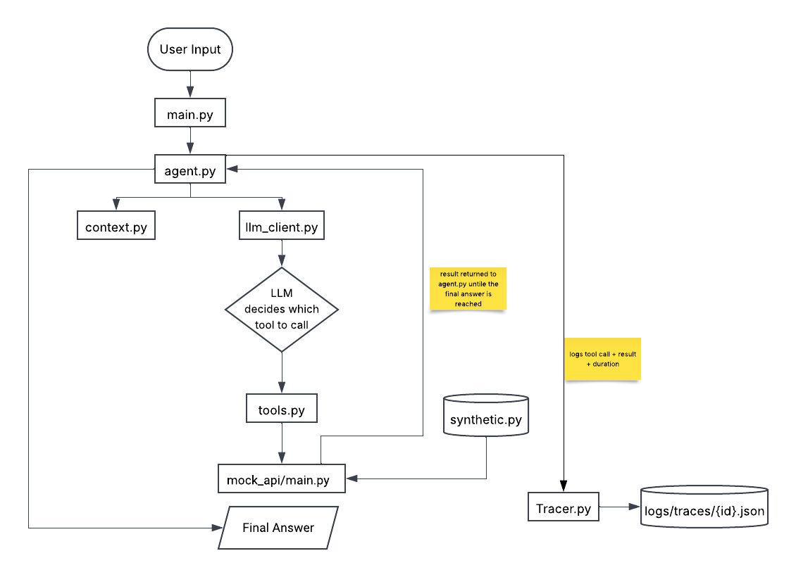

# Cloud Operations AI Agent

An AI agent that understands natural-language requests about cloud infrastructure, calls the right APIs, and returns clear answers.

## Architecture



## Stack

- **Python 3.10+**
- **FastAPI** — mock cloud API
- **OpenRouter** (via OpenAI SDK) — LLM with tool calling
- **httpx** — HTTP client for the agent
- **pytest** — testing

## Setup

**1. Create and activate virtual environment**

```bash
python -m venv venv
venv\Scripts\activate        # Windows
source venv/bin/activate     # Mac/Linux
```

**2. Install dependencies**

```bash
pip install -r requirements.txt
```

**3. Configure environment**

```bash
copy .env.example .env
```

Open `.env` and set both required values:

- `OPENROUTER_API_KEY`
- `OPENROUTER_MODEL`

## Running

**Terminal 1 — Start the mock API**

```bash
uvicorn mock_api.main:app --reload
```

Verify it works: open `http://localhost:8000/docs` in your browser.

**Terminal 2 — Run the agent**

```bash
# Interactive mode
python main.py

# Single question mode
python main.py "Find all stopped VMs inactive for more than 7 days"

# Web UI (Streamlit) — opens http://localhost:8501
streamlit run app.py
```

The web UI keeps the conversation across questions. For each answer it shows the tool calls the
agent made, the token usage and how long it took. The sidebar shows whether the cloud API is up
and has a "New conversation" button.

## Mock API Endpoints

| Method | Endpoint                | Description                                               |
| ------ | ----------------------- | --------------------------------------------------------- |
| GET    | `/vms`                  | List all VMs (`?status=stopped&project_id=project-alpha`) |
| GET    | `/vms/{vm_id}/activity` | Get last activity timestamp                               |
| GET    | `/projects`             | List all projects                                         |
| GET    | `/metrics/{vm_id}`      | Get CPU and memory metrics                                |

In interactive mode the conversation is kept for the whole session, so follow-ups like
"which of those are in Project Alpha?" work. Type `reset` to start over.

## How It Works

1. The user's question is added to the conversation context.
2. The LLM receives the full history plus the tool definitions and either asks for tool calls or gives a final answer.
3. Tool calls are executed against the cloud API and the results are appended to the history.
4. Steps 2–3 repeat (max 20 iterations) until the LLM answers.

Data is deliberately split across endpoints (inventory, activity, metrics), so questions such as
"stopped VMs inactive for 7+ days" require chaining several tool calls.

## Error Handling

| Failure | Behaviour |
| --- | --- |
| Unknown VM (404), bad or missing tool arguments, unknown tool | Error returned to the LLM as the tool result, so it can correct itself |
| Path-like `vm_id` from the LLM (e.g. `../projects`) | Rejected before any HTTP request is made |
| Cloud API unreachable | Turn stops with a friendly message (`APIUnavailableError`) |
| LLM rate limit / timeout / 5xx | Retried 3× with exponential backoff, then `LLMError` |
| Bad model name, bad API key, malformed LLM response | Immediate `LLMError` with a fix-it message |
| Max iterations, unexpected bugs | Wrapped as `AgentError`; no stack traces shown to the user |

A failed turn is rolled back from the conversation, so it cannot confuse later questions.

## Execution Traces

Every run (success or failure) writes `logs/traces/<run_id>.json` with each LLM call, tool call
(input and output), error (with its source), token usage per call and in total, and duration.

## Running Tests

```bash
pytest -v
```

The tests need no API key and no running server. The LLM is replaced by a scripted fake
(`tests/conftest.py`) and the mock API runs in-process. Everything else (the agent loop, tool
dispatch, HTTP, context, error handling, traces) is the real code. The suite also runs in
GitHub Actions on every push.

## Project Structure

```
cloud-ops-agent/
├── mock_api/           # FastAPI mock cloud API
│   ├── data/           # Synthetic VM, activity and metrics data
│   └── routers/        # API route handlers
├── agent/              # AI agent
│   ├── agent.py        # Main execution loop
│   ├── llm_client.py   # OpenRouter/LLM integration, retries, response validation
│   ├── tools.py        # Tool definitions + dispatcher
│   ├── context.py      # Conversation history (checkpoint / rollback / reset)
│   ├── errors.py       # AgentError, LLMError, APIUnavailableError
│   └── tracer.py       # Execution trace logger
├── tests/              # Test suite (fake LLM, in-process API)
├── logs/traces/        # Execution traces (auto-created)
└── main.py             # CLI entry point
```
